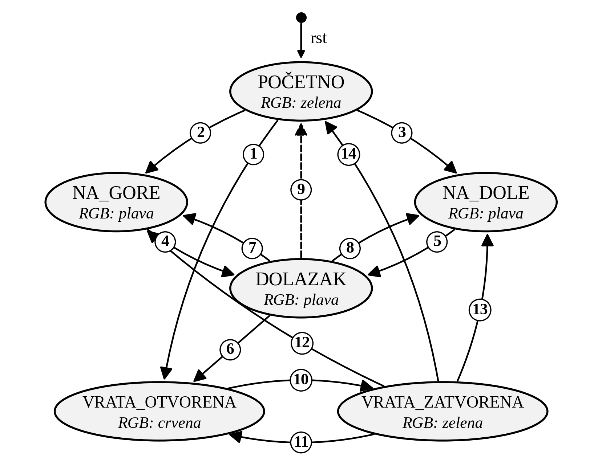
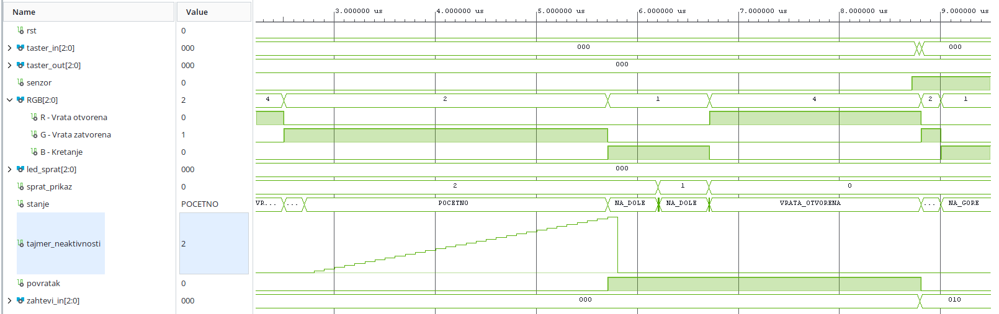

# FPGA Elevator Controller (3 floors, auto-return) — VHDL on Zybo Z7

A 3-floor elevator controller written in VHDL as a finite state machine and implemented on the **Digilent Zybo Z7** board. Built for the **FPGA Design Challenge 2026** (IEEE Student Branch, University of Niš) and used as a university case study.

Team variant **T5 — automatic return**: after 30 s of inactivity the elevator drives itself back to the ground floor and keeps the doors open there until a new request arrives.

## Features

- 3 floors (0, 1, 2) with inside buttons and outside call switches
- Travel time 5 s between adjacent floors, doors open 10 s, door closing 2 s
- Passenger-inside priority: when the cabin sensor is active, inside requests are served before outside calls
- Automatic return to floor 0 after 30 s idle, doors stay open until the next request
- Reset does not "teleport" the elevator: it drives to floor 0 with doors closed and clears all requests
- Status output: 7-segment display (current floor), RGB LED (red = doors open, green = doors closed, blue = moving), LEDs (active outside calls)
- Self-checking testbench (29 checks, 6 scenarios)

## Repository structure

```
src/main.vhd                    Elevator controller (top module)
sim/tb_main.vhd                 Self-checking testbench
constraints/Zybo-Z7-Master.xdc  Pin mapping and 125 MHz clock constraint
docs/                           State diagram and simulation waveforms
```

## Hardware mapping (Zybo Z7)

| Port | Dir | Board resource | Function |
|------|-----|----------------|----------|
| `clk` | in | sysclk (K17), 125 MHz | clock |
| `rst` | in | BTN0 | reset |
| `taster_in[2:0]` | in | BTN1–BTN3 | inside requests (floor 0, 1, 2) |
| `taster_out[2:0]` | in | SW1–SW3 | outside calls (floor 0, 1, 2) |
| `senzor` | in | SW0 | passenger inside the cabin |
| `RGB[2:0]` | out | LED6 (R, G, B) | doors open / doors closed / moving |
| `led_sprat[2:0]` | out | LD0–LD2 | active outside calls |
| `seg7[6:0]` | out | Pmod SSD on JA | current floor |

## Design overview

Synchronous design, single clock domain, asynchronous reset.

- **Input synchronizer** — two flip-flops per input (buttons, switches, sensor).
- **Request registers** — `zahtevi_in` / `zahtevi_out` latch requests; a request is cleared only once the doors open on that floor.
- **Priority mux** — if the passenger sensor is on and an inside request exists, the FSM sees only inside requests; otherwise outside calls.
- **Timers** — 1 s tick generator (`CLK_FREQ` generic), per-state seconds counter, and an inactivity timer (saturating at 30 s), kept separate from the state logic.
- **FSM** — six states: `POCETNO` (idle), `NA_GORE` (moving up), `NA_DOLE` (moving down), `DOLAZAK` (arrival / decision), `VRATA_OTVORENA` (doors open), `VRATA_ZATVORENA` (doors closing).
- **Auto-return** — implemented without extra states: an inactivity timer plus a `povratak` flag that modifies transition conditions in `POCETNO`, `DOLAZAK` and `VRATA_OTVORENA`.

State diagram: [`docs/state_diagram.png`](docs/state_diagram.png)



## Simulation

The testbench `tb_main` instantiates the design with `CLK_FREQ = 10`, so 1 s of real time corresponds to 100 ns of simulation. It runs six scenarios and checks outputs and timing (±0.2 s tolerance) with `assert`:

| # | Scenario |
|---|----------|
| T1 | Reset: floor 0, doors closed, no requests |
| T2 | Outside call from floor 2: LED, 5 s per floor, doors open 10 s |
| T3 | Auto-return after 30 s idle, doors stay open at floor 0 |
| T4 | Inside request while passenger is in the cabin |
| T5 | Inside requests have priority over outside calls |
| T6 | Reset during operation |

Running it in Vivado:

1. Create a project and add `src/main.vhd` as a design source and `sim/tb_main.vhd` as a simulation source.
2. Set `tb_main` as the simulation top and run behavioral simulation (Run All).
3. The Tcl console prints `SVI TESTOVI SU PROSLI` when all checks pass.

Waveforms: [`docs/`](docs/) — full scenario, normal operation, auto-return, priority, reset.



## Building and running on the board

1. Create a Vivado project for the Zybo Z7 (Z7-10 or Z7-20 part, depending on your board).
2. Add `src/main.vhd` (top module `main`) and `constraints/Zybo-Z7-Master.xdc`.
3. Keep the generic `CLK_FREQ` at its default `125_000_000` (the board clock is 125 MHz).
4. Run synthesis, implementation, generate the bitstream, and program the board.

## Notes

- The inactivity timer and all state times use the 1 s tick from `CLK_FREQ`. A mismatch between `CLK_FREQ` and the real board clock changes all timings proportionally (during development, a 100 MHz vs 125 MHz mismatch showed up as a shortened return time).
- The current-floor register has no reset on purpose: after a reset the FSM drives the elevator to floor 0.

## Possible extensions

More floors with direction-aware scheduling (remembering travel direction).

## Authors

| Name | Contribution |
|------|--------------|
| [vantonijevic](https://github.com/vantonijevic) | VHDL implementation, testbench and verification, FPGA implementation and testing on Zybo Z7 |
| [MihajloPi](https://github.com/MihajloPi) | Control algorithm and FSM specification |
| [nikolastankovic03](https://github.com/nikolastankovic03) | Support in VHDL coding |

Developed as a team project for FPGA Design Challenge 2026 (IEEE Student Branch University of Niš) and used as a case study at the Faculty of Electronic Engineering, University of Niš.

## License

MIT — see [LICENSE](LICENSE).
